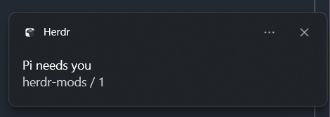

# Desktop notifications



When the Herdr window is inactive, send the title and body of Herdr's in-window toast to the system notification center on **Windows, Linux, and macOS**.

No OSC parsing, status polling, timers, host source changes or remote execution. The original toast's click action and machine-login copy button are preserved. Merely switching away does not replay old notifications. An overlay ID is recorded in that copy's localStorage before delivery so reinitialization does not resend it; message contents are not persisted by this MOD.

## Install

Requires a Herdr version whose generated `AGENTS.md` documents the layout root's `toast` field (tested with 0.1.15).

### With your Herdr agent

```text
Read ~/.config/herdr-app/AGENTS.md, then install this mod and set the current personal layout's root toast field to desktop-notifications (clone a shipped layout first; preserve existing layout content): https://github.com/aqua2k1/herdr-mods/tree/main/mods/desktop-notifications
```

### Manual installation

1. Copy this directory, not a symlink, to `<appHome>/mods/desktop-notifications/`.
2. In a **personal** layout, add this field at the root:

   ```json
   { "toast": "desktop-notifications" }
   ```

   Keep all existing layout fields and children. Do not add a panel/block for this MOD.
   If using a shipped layout, clone it first with
   `herdr-app do layout.clone '{"name":"main","as":"my-layout"}'`
   (this switches layouts), then edit the clone.
3. Run `herdr-app check /absolute/path/to/mods/desktop-notifications`.

Respect `HERDR_APP_HOME` / `XDG_CONFIG_HOME`; the default is `~/.config/herdr-app`. Only layouts with the `toast` field use this MOD. Remove the field to return to the built-in toast.

## Platform dependencies

| Window platform | Delivery |
| --- | --- |
| Linux | `notify-send` and a desktop notification daemon; requests a 60-second expiry |
| Linux under WSL | `powershell.exe`, `wslpath` and standard `od`/`tr` utilities; uses the Windows script |
| macOS | `terminal-notifier`; a Herdr-specific group replaces the previous system notification; OS controls dismissal |
| Windows | Windows PowerShell / WinRT and a registered Herdr or Windows Terminal Start-menu identity |

**Linux setup**

Install `notify-send` using your distribution's package manager:

```sh
# Debian / Ubuntu
sudo apt install libnotify-bin

# Fedora
sudo dnf install libnotify

# Arch Linux
sudo pacman -S libnotify
```

A running desktop notification daemon is also required. Most full desktop environments include one; minimal window-manager setups may need a daemon such as `mako` or `dunst` configured separately.

**macOS setup**

Install the required notification tool:

```sh
brew install terminal-notifier
```

Allow notifications for terminal-notifier in **System Settings → Notifications**. This MOD requires `terminal-notifier`; it has no AppleScript fallback.

Windows prefers Herdr's identity, falling back to Windows Terminal for unpackaged/WSL installs. In the fallback case Windows labels the notification as Terminal. Its fixed Herdr tag/group replaces the previous toast, with one-minute expiry.

Allow notifications in OS settings and check Do Not Disturb / Focus settings. Delivery is best-effort: a successful command does not prove that the OS displayed a banner. Launch failures and nonzero exits are logged; they never create another toast or affect the original notification. One attempt, a five-second exec bound, no retries. Notification text is passed as separate arguments, never interpolated into shell source. Windows/WSL additionally uses prefixed UTF-8 hex transport so PowerShell cannot interpret text starting with `-` as a parameter.

## Scope

Forwards all notifications that Herdr actually creates, including its agent alerts, errors and MOD `notify()` calls. It cannot recover alerts suppressed upstream. Unknown window state is treated as foreground. Lock-screen privacy follows OS settings; full title/body are sent to the OS.

System-notification clicks do **not** restore Herdr or run the original action in this version; the in-app toast still does. No background service remains when the MOD closes.

## Test

```sh
node --test mods/desktop-notifications/test/*.test.js
herdr-app check /absolute/path/to/mods/desktop-notifications
```

Tests exercise delivery conditions, reload deduplication, errors and script arguments using fake notifier programs; they do not post OS banners. On Windows/WSL with Windows PowerShell available, an additional test runs only the real Windows script's parameter binding and text decoder (no toast APIs). Native macOS and Windows notification rendering still requires platform validation.
