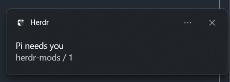

# Desktop notifications

When the Herdr window is inactive, send the title and body of Herdr's in-window toast to the system notification center on Windows, Linux, and macOS. For example, an agent waiting for input can show “Pi needs you” above “herdr-mods / 1” in a desktop banner.

## What you see

- The desktop banner uses the operating system's notification styling. It contains the original title and body; its app identity depends on the platform and installation. The preview shows a Windows notification attributed to Herdr.
- Inside Herdr, retain a full-size horizontal toast with 18px horizontal padding and a 12px gap, centered vertically, using the theme's popover background and hover background.
- On the left, show the supplied icon at 18×18px. Without an icon, show an 8px rounded status dot: error uses the blocked color, warning the working color, success the done color, and info or unknown levels the accent color.
- On the right, show a truncated 13px semibold foreground title and, when present, a truncated 12px muted body.
- For the exact machine-login message `<machine> needs login; run hc machine login <machine>`, show a login prompt, the command with a tooltip, and a Copy button. After copying, its label becomes Copied.

## How it behaves

- Forward notifications Herdr actually creates, including agent alerts, errors and MOD notifications. Do not independently watch working, blocked, done or idle agent states, and do not invent alerts for transitions Herdr does not report.
- Capture the window state when the toast initializes. Send a system notification only when `active` is explicitly false. An active or unknown window state keeps only the in-window toast.
- Switching away later must not replay an existing toast. Record the overlay ID before deciding whether to send; reinitializing the same recorded overlay must not resend it. Store only the last overlay ID, not the message contents.
- Make one delivery attempt with a five-second execution timeout, no retries, polling or timers. Log failures without posting another toast or breaking the original one.
- Clicking the in-window toast runs its supplied action, if any, then dismisses the overlay. Hover changes its background. Clicking Copy copies the login command without running the toast action or dismissing it. No new keyboard shortcuts are added.
- System-notification clicks do not restore Herdr or execute the original action. Do not promise that behavior.
- Linux requests a 60-second expiry. Windows uses a fixed Herdr group/tag, replacing the previous matching notification, with a one-minute expiry. macOS uses a fixed Herdr notification group; the OS controls dismissal.

## Built from

- One MOD with `mod.json` containing `{ "place": "none" }`, a `main.js` toast view, a delivery helper in `lib/delivery.js`, and platform scripts in `scripts/`. No layout file or panel/block is needed.
- Use `View`, `div` and `image` from `gpui-kit`, and `h_flex` / `v_flex` from `gpui-base` for the in-window UI.
- Use Herdr's `props`, `theme`, `window`, `appHome`, `exec`, `run` and `closeOverlay` APIs. Props supply `overlay`, `title`, `body`, `level`, `icon` and optional `action: { name, args }`. Initialize delivery through `cx.spawn`, outside rendering. Use `cx.write_to_clipboard` for Copy and `cx.notify` to refresh its label.
- Use MOD-local `localStorage` key `desktop-notifications.overlay` to remember the last overlay ID. Require a nonempty string overlay ID and title; treat a non-string body as empty.
- Resolve scripts under `<appHome>/mods/desktop-notifications/scripts/`. On Linux and macOS invoke their shell wrappers through `/bin/sh`; on Windows invoke `powershell.exe` directly. Pass notification text as separate arguments, never interpolate it into executable shell source.
- Linux: run `notify-send --app-name=Herdr --expire-time=60000 -- <title> <body>`. This requires a desktop notification daemon.
- macOS: require `terminal-notifier`, passing title, message and group `herdr-notification`. Follow its documented leading-backslash convention for text arguments so text starting with `-` is not interpreted as an option. There is no AppleScript fallback.
- Windows: use Windows PowerShell with `-NoLogo -NoProfile -NonInteractive -ExecutionPolicy Bypass -File`, then a local script using WinRT toast APIs. Transport title/body as `hex:`-prefixed UTF-8 hexadecimal arguments and decode them in the script. Prefer a registered Herdr Start-menu identity; otherwise use Windows Terminal. Build XML text nodes rather than interpolating XML.
- WSL: detect `WSL_DISTRO_NAME` or `WSL_INTEROP` in the Linux wrapper, use `wslpath` to locate the Windows script, encode text with `od` / `tr`, and invoke `powershell.exe`.
- Before installation, disclose that this MOD runs local programs and sends full notification text to the OS. It makes no network requests and does not intentionally read user documents. The Windows script queries registered Start-menu applications.
- Read the target installation's `AGENTS.md` first. Respect `HERDR_APP_HOME` / `XDG_CONFIG_HOME`; the default home is `~/.config/herdr-app`. Copy the runtime MOD directory, not a symlink, to `<appHome>/mods/desktop-notifications/`; do not install recipe or preview assets as runtime dependencies.
- Preserve the current personal layout and add only its root field `"toast": "desktop-notifications"`. If the active layout is shipped, clone it first using `layout.clone` and edit the personal copy. Do not add a zero-height block or move layout nodes. On a name collision, ask or rename the MOD and update both the toast field and its internal script path.

## Watch out

- Requires a Herdr version whose generated guide documents the root `toast` field; the existing build was tested with 0.1.15. Do not patch host source to compensate for an unsupported version.
- Only layouts selecting this toast MOD use it. Removing the root `toast` field restores the built-in toast.
- This forwards existing toasts, not agent state. It cannot recover alerts suppressed upstream, and being on a different tab while the window remains active does not itself trigger delivery.
- Deduplication remembers only the last overlay ID, not a permanent history. Do not describe it as unlimited exactly-once delivery across all overlays.
- Linux requires `notify-send`; macOS requires `terminal-notifier`; WSL requires `powershell.exe`, `wslpath`, `od` and `tr`; native Windows requires Windows PowerShell/WinRT and a registered Herdr or Windows Terminal identity. Missing dependencies must fail safely, not trigger installation without consent.
- Windows fallback notifications may be labeled Terminal. System permission settings, Do Not Disturb / Focus and lock-screen privacy apply. A zero exit code is not proof that a visible banner appeared.
- Keep argument boundaries intact for quotes, newlines, Unicode and leading hyphens. Windows/WSL need the prefixed hex transport specifically to avoid PowerShell parameter binding treating message text as flags.
- Keep full message text out of MOD persistence. The OS still receives and may retain the full title/body according to its settings.
- The machine-login special case accepts machine names matching `[a-z0-9][a-z0-9_.-]{0,31}` and requires the same name in both parts of the message. Other bodies render normally.

## Done when

- `herdr-app check /absolute/path/to/mods/desktop-notifications` passes in the target installation.
- `node --test mods/desktop-notifications/test/*.test.js` passes from this repository's root. Tests use fake notifier programs and must not post real OS banners; the optional Windows/WSL test exercises parameter decoding without calling toast APIs.
- A valid new toast initialized while Herdr is inactive makes one platform delivery attempt with its original title/body. Active or unknown window state, invalid props, unsupported platforms and the last recorded duplicate overlay do not deliver.
- Reloading the same recorded toast or switching away after foreground initialization does not replay it. Delivery errors are logged and leave the in-window toast usable.
- In-window title/body, severity dot or icon, hover, action/dismiss behavior and machine-login Copy/Copied interaction remain intact.
- With notification permission and dependencies available, a manual inactive-window test produces a desktop banner. Validate rendering separately on each target platform; automated command tests alone do not prove native banner delivery.
- The existing layout content is unchanged apart from the root toast selection, no extra block or service is installed, and removing that selection returns to the built-in toast.
