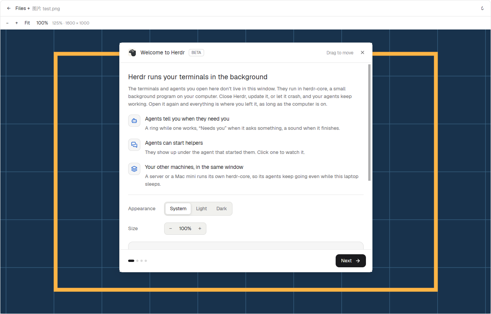

# Files Plus

A native enhancement of Herdr's Files MOD, not a WebView. Keeps the original lazy tree, indentation, SVG icons, expanded-folder state and focused folder/machine following. Removes Git status queries and badges. Only the file-opening/rendering route changes:

```text
Herdr management | workarea: terminal pane + file preview pane | Files / Changes
```

Files stays in the right sidebar. Clicking a file creates a native preview pane to the right of the current work pane, **inside the active tab's workarea**. Later clicks reuse that tab's preview. Native pane zoom/resize/close work independently; closing the preview keeps Files and its tree state.



## Features

- **Code:** native syntax-highlighted editor, line numbers, selection/copy; read-only. Code and Markdown use `settings().font_family` / `font_size` (terminal font settings), updating when settings change rather than hardcoding 12px. Layout-specific terminal font overrides are not independently resolved.
- **Markdown:** native preview / original source toggle. Images and raw HTML are displayed as inert text; links do not open. Relative/embedded image rendering is a follow-up, not currently supported.
- **PNG/JPEG:** Fit, 100%, zoom buttons, pointer-anchored Ctrl/Cmd-wheel zoom, wheel pan and mouse drag. Original bytes are preserved; no downsampling or extra pixel-count limit.
- **PDF (optional):** vertically continuous pages, native scrolling, original previous/next arrows with a page counter, Fit width, 100% and zoom. Arrows scroll to the neighboring page; no page-number input is added. Mixed page sizes/rotation are measured first; a native virtual list renders only visible pages plus one neighbor on each side, evicting offscreen bitmaps. Remote PDFs use the same bounded download, then render **locally**; no remote PDF package required. No text search/selection, forms, JavaScript, OCR or encrypted PDFs.
- **Remote:** uses existing Herdr machine connections; target OS is detected independently of the client OS.

### Current boundaries

- The shared media reader accepts **up to 5 MiB (5,242,880 bytes)** per image / remote PDF. Reads in chunks of at most 1 MiB, with content/metadata version checks and a final recheck. This avoids the additional Base64 envelope in `hc` overflowing the host's 8 MiB output limit.
- POSIX targets need `sh`, `stat`, `dd`, `mktemp`, `base64` and `sha256sum` or `shasum`; Windows uses Windows PowerShell/.NET. Helpers are sent inline, not installed on the remote machine.
- Text uses the host's 1 MiB UTF-8 read API; display is capped at 400,000 characters. Manual refresh reloads the current preview; the native folder watcher / 10-second polling refreshes the tree.
- No artificial image pixel cap, but decoder, GPU texture and available-memory limits still apply. Full decode failures may only appear in the host log; magic/header checks do not replace a full image decoder.
- Resource cleanup is best effort after crashes or forced termination. A viewer keeps one image or the visible PDF pages and neighbors; several MOD instances can still exist.

## Install

### With your Herdr agent

```text
Read ~/.config/herdr-app/AGENTS.md, then replace the Files panel with this mod: https://github.com/aqua2k1/herdr-mods/tree/main/mods/files-plus
```

### Manual installation

Copy this whole directory (not a symlink) to `<appHome>/mods/files-plus/`, then run:

```sh
herdr-app check ~/.config/herdr-app/mods/files-plus
```

Use your actual `HERDR_APP_HOME` if overridden. Clone your current layout before replacing its Files block's `content.mod` with `files-plus`; preserve its IDs and other configuration. See [layout integration](../../integrations/files-plus/README.md). The shipped `files` MOD is not changed.

### Optional PDF dependencies

Python 3.9+ with **pypdfium2** and **Pillow** must already be installed on the **client**. Nothing is downloaded or installed automatically. If desired, install them into the Python environment Herdr uses:

```sh
python3 -m pip install pypdfium2 Pillow
```

The default executable is `python3` on POSIX and `python` on Windows. A block prop `"python": "python"` or `"python": "py"` overrides this (`py` uses `-3`). The helper uses fixed argv and a 15-second timeout. Metadata is bounded to 10,000 pages / 2 MiB JSON; PDF-only limits are 16 million rendered pixels and 16 MiB per output PNG. These do not limit source image pixels. A separate process is crash isolation, **not an OS security sandbox**. Preview only trusted PDFs until sandboxing is added.

These packages/PDFium have their own licenses; this MOD does not bundle their binaries. Tested optional packages: pypdfium2 5.11.0 and Pillow 12.2.0.

## Props and commands

No props: the sidebar follows the focused pane/space like native Files. Optional `{ "root": "/path/to/project", "on": null }` pins the sidebar directory. `on` is an existing machine name, or null for local.

Preview panes are created internally with `{ role: "preview", tab, channel, root, on, file }`; `file` is relative to `root`. Their source stays fixed when focus changes. Since the host cannot update existing pane props, per-tab shared requests update the existing preview; one preview is reused per tab. Closing it releases native Editor/media resources and its shared request. The sidebar does not need to be recreated. Native model panes may still be saved/restored by Herdr itself; this MOD does not override core persistence.

Shown copies accept `files-plus.refresh`, `.source`, `.fit`, `.actual`, `.zoom-in`, `.zoom-out`, `.previous`, `.next`, `.zoom-pane` and `.close-preview`. These commands have no arguments and reach shown copies; preview-only actions do not act on the sidebar. Escape / `.back` closes a model preview, not Files. +/−, 0 (Fit), 1 (100%) control the focused image viewer. Use Herdr's native pane header for pane zoom and close; no duplicate buttons are drawn inside the preview. Image +/- controls the image, not the pane. Images and PDFs share Ctrl/Cmd-wheel zoom; ordinary PDF wheel input stays native continuous scrolling.

## Resource lifecycle

Temporary media is stored **under `appHome/layouts/files-plus-assets/`**, not in this repository and not under `mods/`. This is deliberate: Herdr's native watcher invalidates decoded GPUI assets for changes under `layouts/`; it does not do this for `data/` or `cache/`. Unlinking an unwatched asset would leave its decoded native image cached. No layout JSON is modified by this cache, and asset events do not reload MOD code.

Native Windows Herdr 0.1.16 was observed writing empty files for `fs.writeFile(Uint8Array)`. Its compatibility adapter (`lib/platform-compat.js`, with host services bound by `lib/cache-writer.js`) stages bounded Base64 **text** under `data/files-plus-staging/`, then atomically publishes bytes with PowerShell/.NET. Payloads are not passed in argv, and no machine-specific paths are hardcoded. `resources.js` only owns the lifecycle; other platforms retain direct native writes. Large codecs yield between small blocks to stay within the host VM's execution budget.

Each viewer has an independent owner directory/lease. Switching files removes old assets; closing revokes the lease. The PDF helper checks that lease before and after publishing, so a render finishing after the viewer closes does not leave its output. Disk cleanup is tested; native eviction depends on the host's watched-asset implementation. There is no public direct GPUI eviction API.

## Tests

```sh
npm test
npm run test:files-live
npm run test:files-live -- --remote <connected-machine>
npm run test:files-live -- --stress
npm run test:files-panes
npm run test:files-panes -- --keep
```

Native Windows image regression (real GUI, PNG/JPEG/5 MiB, checksums and staging cleanup):

```powershell
powershell.exe -NoProfile -ExecutionPolicy Bypass -File scripts/test-files-plus-windows.ps1
```

The renderer live test opens a real, isolated Herdr window, creates real PNG/JPEG/Markdown/code/two-page PDF fixtures, takes screenshots and verifies rendered image/PDF colors (including both adjacent pages in one continuous view), checks zero Markdown network requests and cache cleanup. The separate `test:files-panes` uses the native three-column workspace and a dedicated test tab to verify right split, same-tab reuse, native zoom, close/reopen, expanded folder icons/indentation and terminal font settings. It calls the production click handler through a test-only subclass, not a synthetic pane model; `--keep` leaves that window/tab open for manual clicks. It leaves screenshots plus `results.json` in `~/.cache/files-plus-live-*`; it does not modify your personal layout or installed MODs. It requires a desktop display and the optional PDF dependencies. `--remote` creates and removes temporary fixtures on that machine. `--stress` additionally switches images twelve times and records Linux RSS (not a GPU-memory measurement).

See [verification record](TESTING.md) for actual results and unverified platforms. Passing Node mocks is not a claim of Windows/macOS GUI compatibility.

## Attribution

Tree/folder-following/editor behavior is derived from Herdr's native Files implementation, Apache-2.0; see `LICENSE-Apache-2.0.txt`. Image interaction design also references [Zed's GPUI image viewer](https://github.com/zed-industries/zed/blob/main/crates/image_viewer/src/image_viewer.rs); no Zed code was copied. Research and later phases: [plan](../../docs/files-plus-plan.md).
